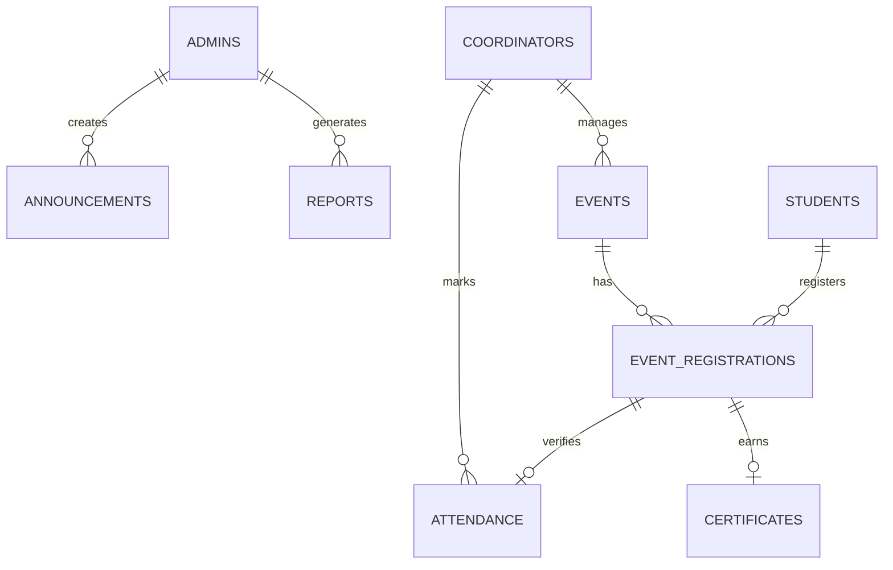
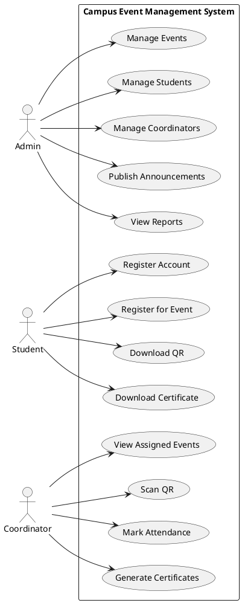
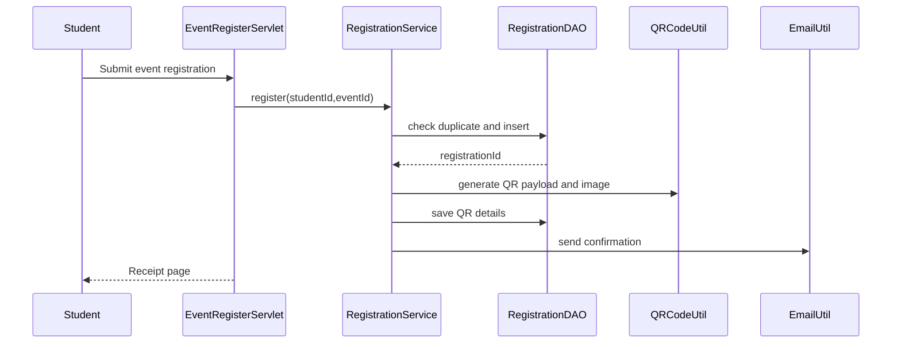
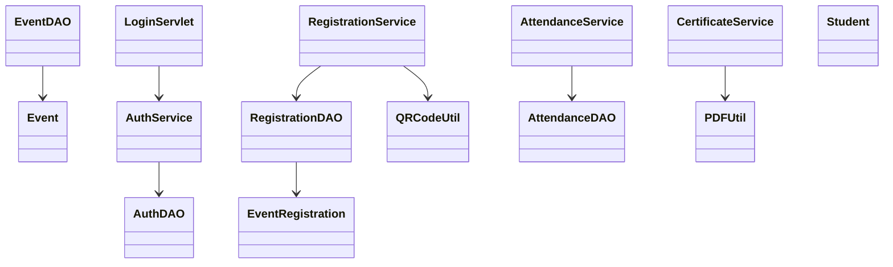

# Campus Event Management System Diagrams

## ER Diagram

## Use Case Diagram

## Sequence Diagram

## Class Diagram

## Database Schema Documentation

The database is normalized around role-specific users, events, registrations, attendance, certificates, announcements, reports and login audit records. Foreign keys enforce ownership and event assignment. Views provide report-friendly projections. Triggers prevent registration for unapproved or full events.
